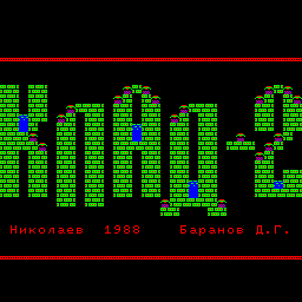
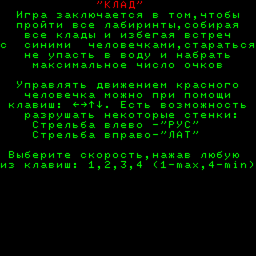
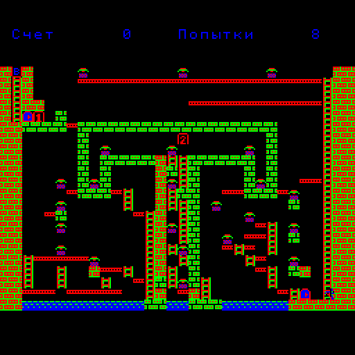

# КЛАД-2 — Linux/SDL2-порт

Декомпиляция оригинального бинарника игры **КЛАД-2** (Электроника
БК-0010, автор Баранов Д.Г., 1988 г.) в портативный Си-код,
исполняемый под Linux с графикой и звуком через SDL2.

Цель — функциональный аналог с **точным воспроизведением алгоритмов
и спрайтов** оригинала, проверяемый бит-точно через A/B-сравнение с
эталонным интерпретатором.

## Скриншоты

| Заставка | Меню правил | Уровень 1 |
|----------|-------------|-----------|
|  |  |  |

## Сборка и запуск

```sh
make
./klad2          # запуск со встроенными ассетами (рекомендуется)
```

Зависимости: `gcc`/`clang`, `make`, `SDL2-devel` (на Fedora —
`dnf install SDL2-devel`).

Бинарник **самодостаточен** — внешние файлы (`KLAD2.BIN`,
`bk10_017_mon.rom`) не требуются. Шрифт БК, образ Monitor-ROM и
начальное состояние КЛАД-2 после релокатора встроены в исполняемый
файл (`src/klad2_font.c`, `src/klad2_mon_rom.c`,
`src/klad2_initial.c`).

### Управление

- **Стрелки** — движение игрока (вверх по лестнице, вниз, влево, вправо).
- **Shift / Ctrl** — стрельба влево / вправо (РУС / ЛАТ на БК-клавиатуре).
- **Enter** — на заставке: переход в меню правил.
- **Цифры 1..9** — в меню правил: запуск уровня.
- **Esc** — выход.
- **F11** — полноэкранный режим (toggle).
- **Pause / F9** — пауза (CPU останавливается).
- **F12** — снимок всей памяти БК в файл `klad2_dump_HHMMSS.bin`.

### Опции командной строки

```
./klad2 [опции] [путь/к/KLAD2.BIN]
```

| Флаг | Что делает |
|------|------------|
| `--scale N` | Увеличение окна 1..4× (по-умолчанию 3, 768×768 пикс.) |
| `--speed N` | Инструкций PDP-11 за кадр (по-умолчанию 4000) |
| `--save-state path` | Прогнать PIC-релокатор, сохранить snapshot, выйти |
| `--fast-start path` | Загрузить snapshot вместо встроенного состояния |
| `--rom path` | Подменить встроенный шрифт/Monitor-ROM из ROM-файла |
| `--trace` | Очень многословная трасса каждой PDP-11 инструкции |
| `--max-steps N` | Остановить ЦП после N инструкций (полезно для дампа) |
| `--dump-memory path` | Дамп всей памяти БК при HALT/max-steps |
| `--auto-keys "F:K,..."` | Скриптовый ввод: на кадре F нажать клавишу K |

### Переменные окружения

| Переменная | Эффект |
|-----------|--------|
| `KLAD2_TRACE_C=1` | Сводка вызовов C-замен при выходе |
| `KLAD2_JSR_PROFILE=path` | Сохранить топ-50 JSR-целей в файл |
| `KLAD2_AB=<oct>` | A/B-сравнение C-замены с интерпретатором |
| `KLAD2_AB_REGS=1` | A/B-сравнение также регистров и PSW |
| `KLAD2_NO_C_ROUTINES=1` | Отключить ВСЕ C-замены (чистый интерпретатор) |
| `KLAD2_EMT_LOG=1` | Логировать все EMT-вызовы |
| `KLAD2_TIMER_LOG=1` | Логировать обращения к BK-таймеру |

## Архитектура

Гибридная: внутри одного процесса крутится мини-интерпретатор
КР1801ВМ1 (PDP-11-совместимый ЦП БК-0010), исполняющий КЛАД-2 поверх
виртуальной БК (`uint8_t bk_mem[64K]` + шимы видео/звука/клавиатуры
через SDL2). Подпрограммы поштучно заменены на ручные Си-реализации;
диспетчер `routines_lookup` в `pdp11_step` при попадании PC в
«реализованную» область вызывает C-функцию вместо декодирования.

На момент текущей версии:

- **33 C-замены** в продакшене.
- **Все 7 hot функций main loop'а** покрыты C-заменами (телепорты
  врагов, обработчики ИИ E1/E2, обработчик спецтайлов, двойной
  таймер, delay loop).
- За 12 сек gameplay уровня 1 — **177775 JSR-вызовов**, из них
  большинство уходят в C-замены; интерпретатор обрабатывает только
  отдельные редкие пути и внутренние ветки.
- A/B-проверка показывает **0 расхождений по памяти** на 100k+
  вызовов в gameplay (2 минор PSW edge cases на 100k+).
- **28/28** юнит-тестов интерпретатора PDP-11/КР1801ВМ1 проходят.

Подробности — в `CLAUDE.md`.

## Структура исходников

```
src/
├── main.c              — SDL2-цикл, парсер CLI, init+teardown
├── pdp11.c/.h          — интерпретатор PDP-11/КР1801ВМ1 + AB-инфра
├── bk.c/.h             — виртуальная БК: bk_mem, регистры, таймер
├── video.c/.h          — bk_mem[видео] → SDL_Texture
├── audio.c/.h          — SDL2-аудио (write-strobe + BEL)
├── input.c/.h          — SDL_KEY* → REG_KEY_*, REG_PAR_INTERF
├── emt.c/.h            — EMT 6/14/16/20/22/24 + цветные коды 0o22x
├── routines.c/.h       — 33 C-замены подпрограмм КЛАД-2
├── klad2_font.c        — встроенный шрифт БК (2080 байт)
├── klad2_mon_rom.c     — встроенный Monitor-ROM (8 КБ)
├── klad2_initial.c     — начальное состояние bk_mem + регистры
└── test_pdp11.c        — юнит-тесты декодера (28 проверок)
```

## Воспроизведение скриншотов

```sh
# Заставка
./klad2 --max-steps 200000 --dump-memory /tmp/title.bin

# Меню правил
./klad2 --auto-keys "60:Enter" --max-steps 400000 \
        --dump-memory /tmp/menu.bin

# Уровень 1
./klad2 --auto-keys "60:Enter,180:1" --max-steps 800000 \
        --dump-memory /tmp/game.bin
```

Конвертация в PNG — см. `tools/` или python-скрипт в истории
коммитов (читает байты `0o40000..0o60000` как 4-цвет БК-палитру).

## Лицензия и происхождение

Оригинальный бинарник КЛАД-2 (`KLAD2.BIN`) — творение Баранова Д.Г.
(1988), права у автора. Этот порт — декомпиляция в учебных и
архивно-исторических целях; код порта распространяется свободно.

`bk10_017_mon.rom` (Monitor ПЗУ БК-0010) — публично доступен в БК-
сообществе как часть документации советских ЭВМ.
